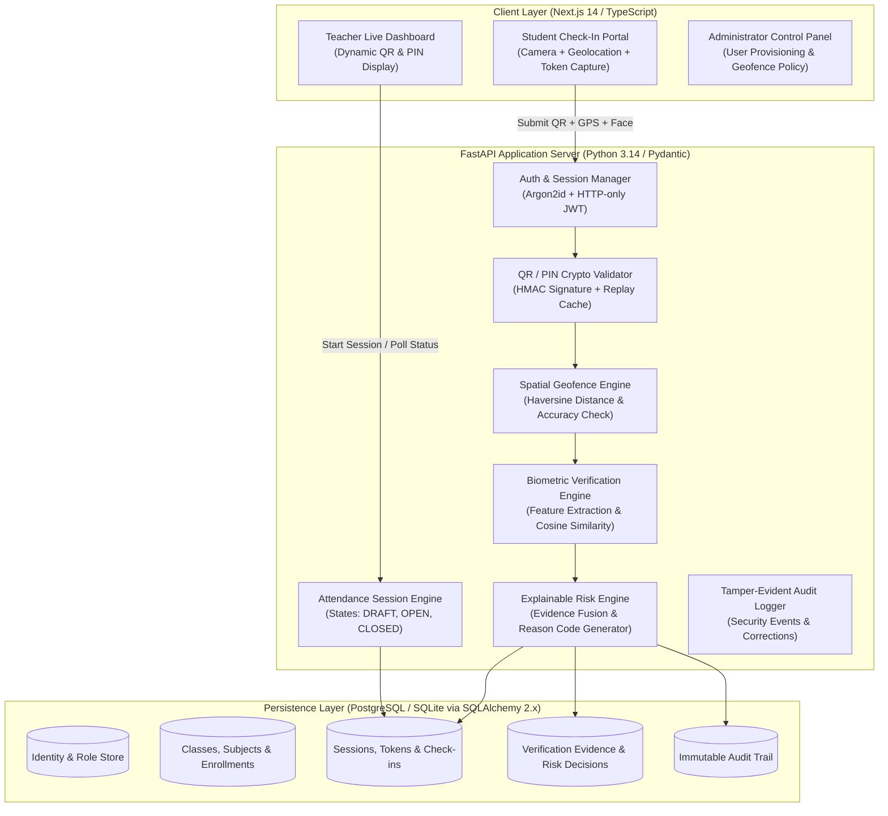

# ATTENDX AI — Architectural Blueprint
**Institutional Context**: ZEAL College of Engineering & Research, Pune, Maharashtra, India  
**System Type**: Smart Attendance & Anti-Proxy Verification System (Dedicated, Independent)

---

## 1. Executive Architectural Overview

AttendX AI is a dedicated, institutional-grade attendance verification platform designed specifically to eliminate attendance fraud (proxy attendance) through an **explainable, multi-factor evidence-based verification architecture**.

Unlike generic ERPs or simple QR check-in apps, AttendX AI establishes **Server-Authoritative Verification**:
- **Dynamic Cryptographic QR Tokens**: Short-lived (30s default), HMAC-SHA256 signed, unreplayable, and synchronized to the server clock.
- **Dynamic Temporary PINs**: High-entropy cryptographically generated fallback PINs for environments where camera capture is impaired.
- **Geofence Spatial Evidence**: Haversine-computed boundary validation comparing client-reported GPS/accuracy with institutional classroom coordinates (e.g. ZEAL Narhe Campus, Building A/B/C).
- **Face Verification**: Biometric embedding comparison between enrolled student reference vectors and live capture submissions with strict similarity thresholds.
- **Genuine Liveness Detection**: Evaluation of spoofing vectors (screen replay, photo cutouts) with explicit fallback when unconfigured.
- **Explainable Multi-Factor Risk Engine**: Deterministic, transparent rules fusing all verification signals into explicit, audited outcomes (`ACCEPTED`, `REJECTED`, `REQUIRES_REVIEW`).
- **Controlled Teacher Review & Audit Trail**: Full ledger of manual corrections, including acting teacher, previous state, new state, justification, and immutable timestamps.

---

## 2. Evidence Fusion & Decision Matrix

AttendX AI avoids "black-box" decision-making. Every attendance check-in evaluates an explicit evidence matrix:

| Factor | Evidence Source | Valid / Passed Criteria | Failure Handling |
| :--- | :--- | :--- | :--- |
| **Token Validity** | Signed QR Token | Valid HMAC signature, unexpired, matches session ID | Immediate Reject (`INVALID_TOKEN` / `EXPIRED_QR`) |
| **PIN Fallback** | 6-Digit Server PIN | Matches active session PIN, rate limit not exceeded | Max 5 attempts; rate-limited lock |
| **Session State** | Server Clock & State | Session status is `OPEN`, time is within window | Immediate Reject (`SESSION_CLOSED` / `OUTSIDE_WINDOW`) |
| **Enrollment** | Academic Records | Student enrolled in the target Subject & Class | Immediate Reject (`STUDENT_NOT_ENROLLED`) |
| **Geofence** | Browser W3C Geolocation | Distance $\le R_{max}$ from classroom anchor | If distance > radius: `GEO_OUT_OF_BOUNDS`. If permission denied: `GEO_PERMISSION_DENIED` |
| **Face Match** | Live Camera Capture | Cosine similarity $\ge$ configured threshold (0.75) | Similarity < 0.75: `FACE_MISMATCH`. No face: `NO_FACE_DETECTED` |
| **Liveness** | Anti-Spoof Analyzer | Passive texture/challenge response meets score | If failed: `LIVENESS_FAILED`. If disabled: explicit `NOT_CONFIGURED` |

### Risk Decision Outcomes:
1. **ACCEPTED (Green)**: All required factors passed within institutional tolerance. Attendance officially recorded.
2. **REQUIRES_REVIEW (Amber)**: Token passed, but secondary evidence (e.g. GPS indoor drift or marginal face match) is inconclusive. Sent to Teacher Review Queue.
3. **REJECTED (Red)**: Security invariant violated (e.g. expired QR, duplicate attempt, student not enrolled, token replay).

