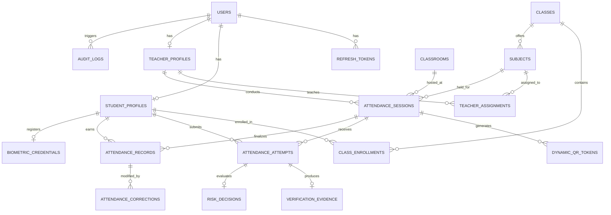

# ATTENDX AI — Database Design & Schema Specification
**Target Database Engine**: PostgreSQL (Production) / SQLite3 (Development / Testing)  
**ORM Framework**: SQLAlchemy 2.0 (Declarative Base with Mapped and mapped_column)  
**Migration Tool**: Alembic

---

## 1. Relational Entity-Relationship Diagram

---

## 2. Model Specifications

### 2.1 Identity & Access
- **`users`**:
  - `id` (UUID string, PK)
  - `email` (VARCHAR(255), UNIQUE, Indexed)
  - `password_hash` (VARCHAR(255), Argon2id)
  - `role` (ENUM: `ADMIN`, `TEACHER`, `STUDENT`)
  - `first_name` (VARCHAR(100))
  - `last_name` (VARCHAR(100))
  - `is_active` (BOOLEAN, default True)
  - `created_at` (TIMESTAMP UTC), `updated_at` (TIMESTAMP UTC)

- **`student_profiles`**:
  - `id` (UUID string, PK)
  - `user_id` (UUID, FK -> `users.id`, UNIQUE)
  - `roll_number` (VARCHAR(50), UNIQUE, Indexed)
  - `prn` (Permanent Registration Number - VARCHAR(50), UNIQUE)
  - `department` (VARCHAR(100) - e.g. "Artificial Intelligence & Data Science")
  - `batch_year` (INTEGER - e.g. 2026)
  - `is_biometric_enrolled` (BOOLEAN, default False)

- **`teacher_profiles`**:
  - `id` (UUID string, PK)
  - `user_id` (UUID, FK -> `users.id`, UNIQUE)
  - `employee_id` (VARCHAR(50), UNIQUE, Indexed)
  - `department` (VARCHAR(100))
  - `designation` (VARCHAR(100))

### 2.2 Academic Hierarchy & Physical Classrooms
- **`classrooms`**:
  - `id` (UUID string, PK)
  - `name` (VARCHAR(100) - e.g. "Room 304 - Central Computing Lab")
  - `building` (VARCHAR(100) - e.g. "Building A - ZCOER Narhe")
  - `latitude` (FLOAT - e.g. 18.448500)
  - `longitude` (FLOAT - e.g. 73.824500)
  - `radius_meters` (FLOAT - default 75.0m)
  - `is_active` (BOOLEAN)

- **`classes`**:
  - `id` (UUID string, PK)
  - `name` (VARCHAR(100) - e.g. "TE AIDS Div A")
  - `academic_year` (VARCHAR(20) - e.g. "2026-2027")
  - `semester` (INTEGER - 1 to 8)

- **`subjects`**:
  - `id` (UUID string, PK)
  - `code` (VARCHAR(20) - e.g. "AI401")
  - `title` (VARCHAR(150) - e.g. "Deep Learning & Neural Networks")
  - `class_id` (UUID, FK -> `classes.id`)

- **`class_enrollments`**:
  - `id` (UUID string, PK)
  - `class_id` (UUID, FK -> `classes.id`)
  - `student_id` (UUID, FK -> `student_profiles.id`)
  - *Unique Constraint*: (`class_id`, `student_id`)

- **`teacher_assignments`**:
  - `id` (UUID string, PK)
  - `subject_id` (UUID, FK -> `subjects.id`)
  - `teacher_id` (UUID, FK -> `teacher_profiles.id`)

### 2.3 Attendance Sessions & Cryptographic Tokens
- **`attendance_sessions`**:
  - `id` (UUID string, PK)
  - `subject_id` (UUID, FK -> `subjects.id`)
  - `teacher_id` (UUID, FK -> `teacher_profiles.id`)
  - `classroom_id` (UUID, FK -> `classrooms.id`)
  - `status` (ENUM: `DRAFT`, `OPEN`, `CLOSED`, `CANCELLED`)
  - `checkin_window_minutes` (INTEGER, default 5)
  - `qr_refresh_seconds` (INTEGER, default 30)
  - `current_pin_hash` (VARCHAR(255), salted SHA-256 / argon2)
  - `opened_at` (TIMESTAMP UTC, nullable)
  - `closed_at` (TIMESTAMP UTC, nullable)
  - `require_face` (BOOLEAN, default True)
  - `require_geofence` (BOOLEAN, default True)
  - `require_liveness` (BOOLEAN, default False)

- **`dynamic_qr_tokens`**:
  - `id` (UUID string, PK)
  - `session_id` (UUID, FK -> `attendance_sessions.id`)
  - `token_nonce` (VARCHAR(64), UNIQUE, Indexed)
  - `hmac_signature` (VARCHAR(128))
  - `expires_at` (TIMESTAMP UTC)
  - `created_at` (TIMESTAMP UTC)

- **`attendance_attempts`**:
  - `id` (UUID string, PK)
  - `session_id` (UUID, FK -> `attendance_sessions.id`)
  - `student_id` (UUID, FK -> `student_profiles.id`)
  - `submitted_at` (TIMESTAMP UTC)
  - `method` (ENUM: `QR_CODE`, `PIN_FALLBACK`)
  - `client_ip` (VARCHAR(45))
  - `user_agent` (VARCHAR(255))
  - `decision` (ENUM: `ACCEPTED`, `REJECTED`, `REQUIRES_REVIEW`)

- **`verification_evidence`**:
  - `id` (UUID string, PK)
  - `attempt_id` (UUID, FK -> `attendance_attempts.id`, UNIQUE)
  - `qr_status` (ENUM: `PASSED`, `FAILED`, `EXPIRED`, `NOT_PRESENT`)
  - `pin_status` (ENUM: `PASSED`, `FAILED`, `LOCKED_OUT`, `NOT_USED`)
  - `geo_status` (ENUM: `INSIDE`, `OUTSIDE`, `PERMISSION_DENIED`, `UNAVAILABLE`, `ACCURACY_POOR`)
  - `geo_distance_meters` (FLOAT, nullable)
  - `geo_accuracy_meters` (FLOAT, nullable)
  - `face_status` (ENUM: `MATCH`, `MISMATCH`, `NO_FACE`, `NOT_ENROLLED`, `UNAVAILABLE`)
  - `face_similarity_score` (FLOAT, nullable)
  - `liveness_status` (ENUM: `PASSED`, `FAILED`, `NOT_CONFIGURED`, `UNAVAILABLE`)
  - `liveness_score` (FLOAT, nullable)
  - `evidence_summary` (JSONB / TEXT)

- **`risk_decisions`**:
  - `id` (UUID string, PK)
  - `attempt_id` (UUID, FK -> `attendance_attempts.id`, UNIQUE)
  - `calculated_risk_level` (ENUM: `LOW`, `MEDIUM`, `HIGH`, `CRITICAL`)
  - `primary_reason_code` (VARCHAR(50))
  - `reason_codes` (JSONB / TEXT list of string codes)
  - `action_taken` (ENUM: `AUTO_ACCEPT`, `SEND_TO_REVIEW`, `AUTO_REJECT`)

- **`attendance_records`** (Official Persistent Ledger):
  - `id` (UUID string, PK)
  - `session_id` (UUID, FK -> `attendance_sessions.id`)
  - `student_id` (UUID, FK -> `student_profiles.id`)
  - `status` (ENUM: `PRESENT`, `ABSENT`, `PENDING_REVIEW`, `EXCUSED`)
  - `marked_via` (VARCHAR(50))
  - `attempt_id` (UUID, FK -> `attendance_attempts.id`, nullable)
  - `created_at` (TIMESTAMP UTC)
  - *Strict Uniqueness Constraint*: (`session_id`, `student_id`) prevents duplicate official records.

- **`attendance_corrections`** (Audit of Manual Edits):
  - `id` (UUID string, PK)
  - `record_id` (UUID, FK -> `attendance_records.id`)
  - `teacher_id` (UUID, FK -> `teacher_profiles.id`)
  - `previous_status` (VARCHAR(50))
  - `new_status` (VARCHAR(50))
  - `reason` (TEXT - Mandatory explanation)
  - `timestamp` (TIMESTAMP UTC)

- **`audit_logs`**:
  - `id` (UUID string, PK)
  - `actor_id` (UUID, FK -> `users.id`, nullable)
  - `action` (VARCHAR(100) - e.g. "AUTH_LOGIN_SUCCESS", "ATTENDANCE_CORRECTION", "SESSION_OPENED")
  - `target_type` (VARCHAR(50))
  - `target_id` (VARCHAR(100), nullable)
  - `details` (JSONB / TEXT)
  - `ip_address` (VARCHAR(45), nullable)
  - `timestamp` (TIMESTAMP UTC)

